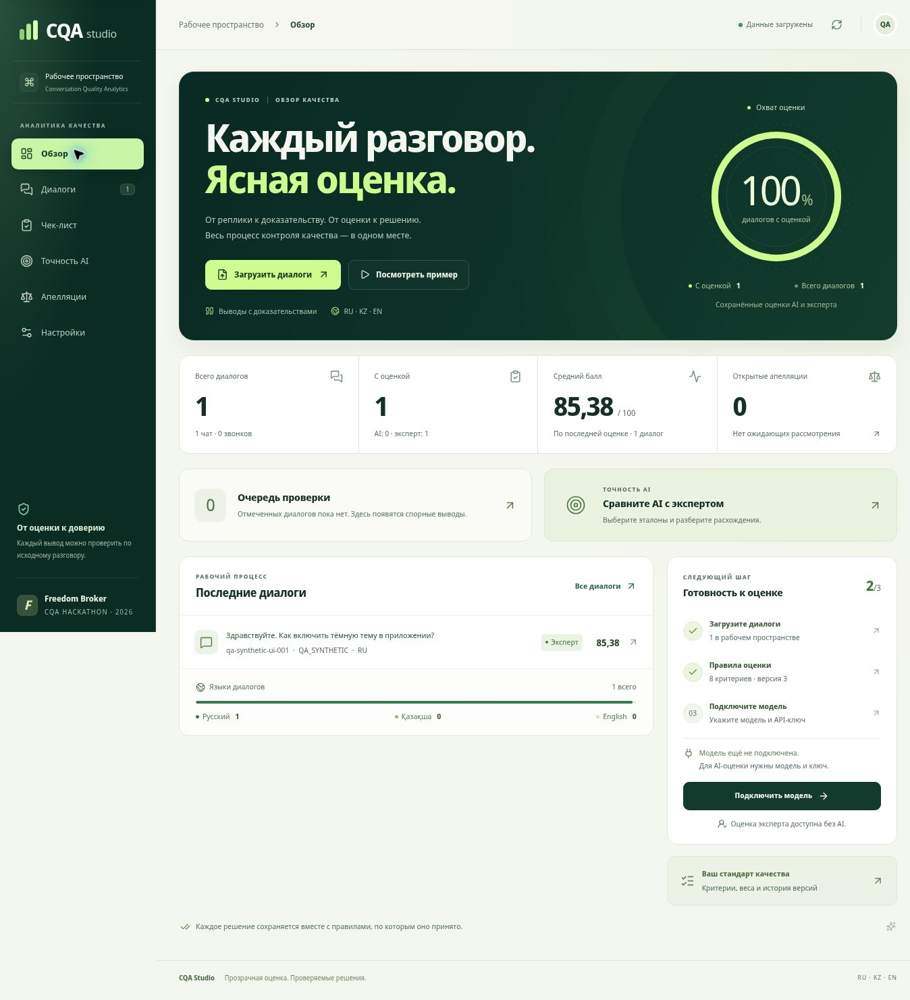
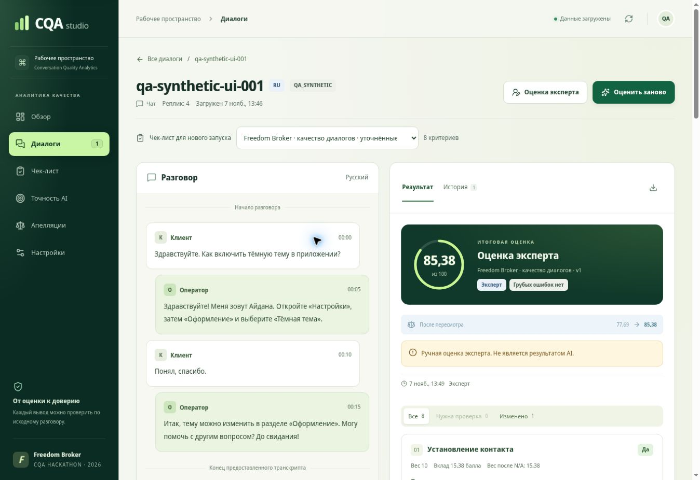
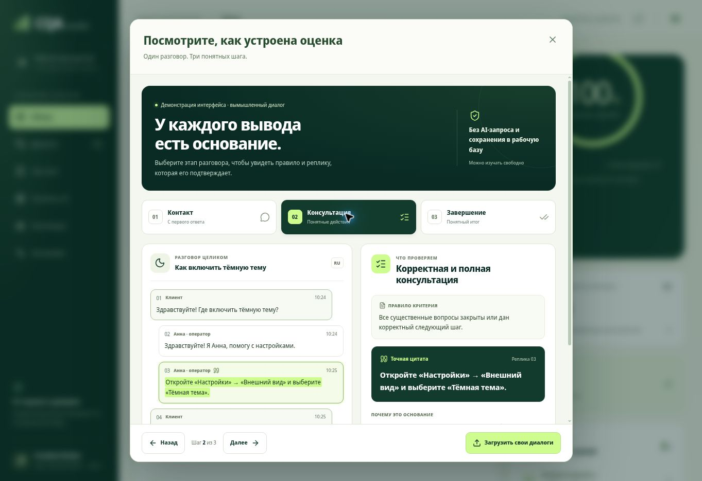
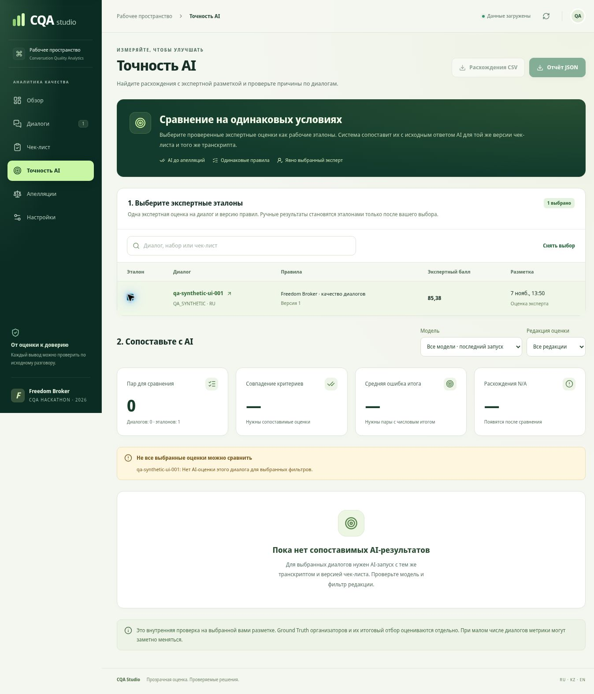
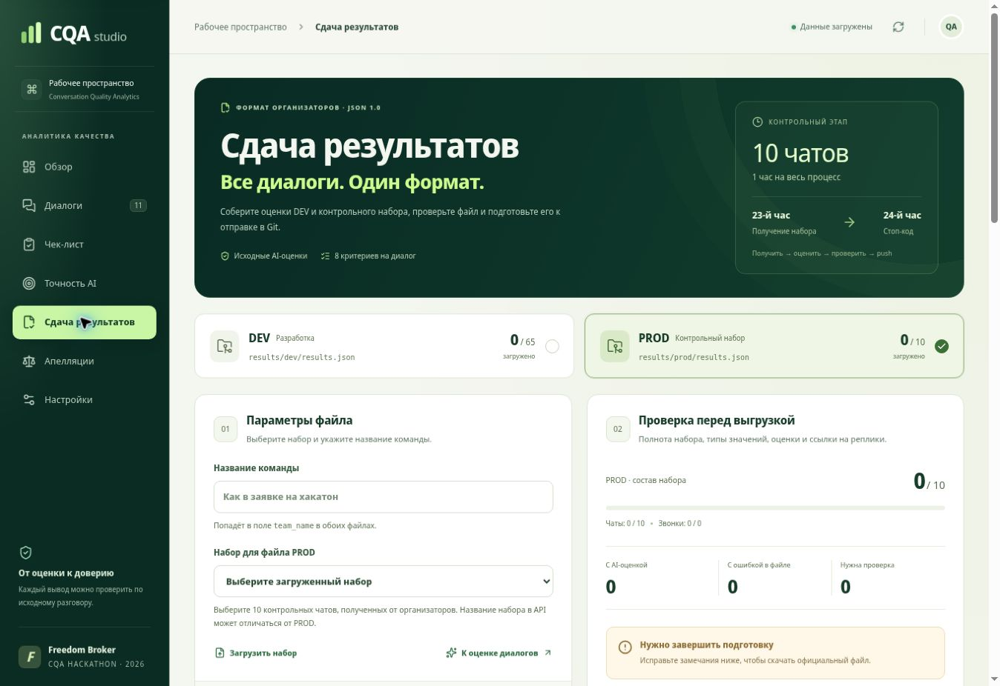

# CQA Studio

Прототип Conversation Quality Analytics для Freedom Broker / CQA Hackathon. Интерфейс на русском; диалоги на RU, KZ и EN. Чаты и звонки используют единый настраиваемый чек-лист. Собственной регистрации нет. Опубликованная частная версия использует доступ платформы размещения.

Публичный репозиторий исходников: [erassylls/doomsday](https://github.com/erassylls/doomsday), основная ветка — `main`.



На иллюстрации — предпросмотр с одним полностью вымышленным диалогом и ручной оценкой. Кольцо показывает **охват оценки**, то есть долю диалогов с сохранённым результатом AI или эксперта. Оно не измеряет точность модели. На пустой базе охват и средний балл отображаются как «—».



На иллюстрации — полностью вымышленный диалог и ручная экспертная оценка для проверки интерфейса. Баллы 77,69 → 85,38 показывают сохранение истории апелляции, а не качество AI относительно Ground Truth.

## Что реализовано

- Главный экран с охватом оценки, рабочими показателями, последними диалогами, очередью проверки и состоянием настройки модели.
- Интерактивный пример «Посмотреть пример»: три этапа, правило и точная цитата с подсветкой контекста. Полностью вымышленный материал, без AI-запросов и записи в рабочую базу.
- Серверная загрузка DEV и контрольных наборов по `group_id`; импорт JSON.
- Список диалогов, поиск и фильтры, карточка с транскриптом и доказательствами.
- Настройка формулировок, секций, весов, типов ответов, ступеней и условий N/A. Каждое сохранение создаёт новую версию чек-листа.
- Уточнённый шаблон v2 с прежними восемью критериями, весами и шкалами; применение открывает черновик для сохранения новой версии.
- Настоящий вызов OpenAI-совместимого Chat Completions API. Подготовленных AI-ответов и скрытой замены модели эвристиками нет.
- Проверка допустимых ответов по каждому критерию и точных цитат из исходных сообщений; подсчёт баллов кодом.
- Дополнительный AI-проход без показа первого ответа, отметка расхождений и конкретные причины неопределённости.
- Отдельный режим экспертной разметки с источником `manual`.
- Раздел «Точность AI»: сравнение исходных AI-результатов с явно выбранными экспертными эталонами, разбор расхождений и экспорт отчёта.
- Апелляция, подтверждение или изменение оценки с причиной, сохранение исходного результата и пересчёт.
- Постоянная SQLite-совместимая база Cloudflare D1.
- Пакетная оценка всего отфильтрованного набора, архивный экспорт, учёт токенов и приблизительной стоимости по введённым тарифам.
- Раздел «Сдача результатов»: официальный JSON 1.0, отдельные DEV/PROD, проверка исходных ID, состава набора, восьми критериев, итогов и нумерации доказательств.
- История неуспешных AI-попыток в базе; явный status=error в формате сдачи вместо пропуска диалога или нулевой оценки.
- Сохранение параметров новых AI-запусков: редакция оценщика, режимы проверки и JSON, отпечаток базы знаний.

## Интерфейс и проверка оснований

Рабочие экраны используют общую зелёно-светлую палитру, локально размещённый шрифт с кириллицей и казахскими буквами, адаптивную компоновку и режим уменьшенного движения. Шрифт CQA Sans подготовлен на основе Noto Sans Display; лицензия находится в [public/fonts/LICENSE.txt](public/fonts/LICENSE.txt).

Нажатие на цитату или проверенный диапазон в карточке переводит фокус на исходную реплику и подсвечивает доказательство. Кнопка «К оценке» возвращает к тому же основанию. Мобильное меню закрывается по Escape, удерживает фокус и исключает фон из навигации; модальные окна поддерживают возврат фокуса и изменение доступности кнопок при выполнении операции.

Показатели главной страницы рассчитываются из сохранённых данных: по одному последнему результату на диалог. Средний балл включает только числовые итоги; рядом с количеством оценок показаны источники AI и эксперт. «Настройки модели заполнены» означает готовность конфигурации, а фактическая доступность провайдера проверяется при AI-запуске.

Демонстрация интерфейса открывается с главного экрана без ключа и без загрузки набора. Подсветка трёх этапов объясняет связь «правило → реплика → основание». Это отдельный учебный пример, а не сохранённая оценка или доказательство качества модели.



## Локальный запуск

Нужны **Node.js 22.13+**, npm и Git; CI использует Node.js 24. Подходят Windows PowerShell или WSL. Исходники не содержат ключей, подписанной ссылки DEV и клиентских транскриптов.

Клонируйте репозиторий, установите зависимости по lockfile и выполните проверки:

```bash
git clone https://github.com/erassylls/doomsday.git
cd doomsday
npm ci
npm run typecheck
npm test
npm run build
```

Эти проверки и сборка не требуют секретов или реальных диалогов. В обычной копии автоматически выбирается переносимый режим; отдельный Sites CLI не требуется. Не переносите `.sites-runtime/execution-profile.json` из другой среды.

Для интерактивного запуска создайте локальный файл переменных из примера. В Linux или WSL:

```bash
cp .dev.vars.example .dev.vars
```

В PowerShell:

```powershell
Copy-Item .dev.vars.example .dev.vars
notepad .dev.vars
```

В `.dev.vars` задайте `DATASET_API_URL`, если нужен импорт из API организаторов. Для AI можно задать серверный `OPENAI_API_KEY` либо ввести ключ в интерфейсе после запуска. Значения задаются отдельно от исходников и не добавляются в Git. Импорт JSON и экспертная разметка доступны без AI-ключа.

Подготовьте локальную D1 и запустите приложение:

```bash
npm run setup:local
npm run dev
```

`setup:local` при необходимости собирает Worker и применяет локальные миграции. Откройте адрес, напечатанный сервером. Для AI-оценки в «Настройках» укажите доступную модель и ключ провайдера, если он не задан серверной переменной. Для импорта набора нажмите «Загрузить диалоги» и выберите API либо JSON-файл. Импорт начинается только по этой команде пользователя.

После изменения переменных перезапустите локальный сервер. У локального и опубликованного приложения разные базы. Для полного сброса локальной базы удалите `.wrangler/state` и `.sites-runtime/local-migrations.json`, затем повторите `npm run setup:local`.

## AI и ключи

Настройки включают базовый URL, идентификатор модели, строгий JSON, дополнительную проверку, цены за миллион входных/выходных токенов и необязательную проверенную информацию компании.

Без ключа и названия модели автоматическая оценка выдаёт сообщение о настройке и не создаёт фиктивный результат. Экспертный режим доступен отдельно и явно обозначен. Ключ из интерфейса находится только в памяти текущей вкладки, не в базе и не в localStorage. При перезагрузке вкладки его нужно ввести снова. Для постоянного подключения задайте секрет на сервере.

По умолчанию базовый URL — `https://api.openai.com/v1`; идентификатор модели выбирает пользователь в соответствии с доступом своего провайдера. Серверный ключ не отправляется на произвольный адрес пользовательских настроек. Секреты и подписанные URL не должны попадать в публичный репозиторий.

[Документация HTTP-контракта Chat Completions](https://developers.openai.com/api/reference/resources/chat/subresources/completions/methods/create).

Для своей LLM нужен совместимый API по HTTPS с публичным доменом, доступный серверу приложения. Прямые адреса `localhost`, частной сети и HTTP в этой версии не принимаются, в том числе при локальном запуске приложения. Ограничение действует на стороне сервера.

Стоимость оценки: `(input_tokens × input_price + output_tokens × output_price) / 1_000_000`. Учитываются все выполненные вызовы. Без введённых цен стоимость не выдумывается. Скидки за кеш и другие особенности биллинга провайдера могут отличаться от этой простой оценки.

## Подсчёт баллов

В исходной конфигурации веса первых семи критериев: **10, 15, 20, 20, 15, 15, 5**. Восьмой критерий — флаг грубого нарушения без баллов и без автоматического обнуления.

Для применимых критериев:

`total = round(100 × sum(weight × normalized_rating) / sum(applicable_weight), 2)`

- Да = 1, Нет = 0.
- Шкальная оценка делится на максимальную ступень.
- N/A исключает критерий из числителя и знаменателя. Нет сохраняет его вес в знаменателе.
- Нет применимых весов — итог `null`.
- Консультация: 0, 5, 10, 15, 20. Ведение диалога: 0, 4, 7, 10. Например, 7/10 при весе 15 дают 10.5 балла до перераспределения.
- Округляется итог до двух знаков; промежуточные вклады сохраняют точность.

Версия чек-листа сохраняется внутри оценки. Её редактирование не меняет прошлые результаты. Апелляция пересчитывается по версии исходной оценки. Первоначальные оценки и балл остаются доступны.

### Уточнённый шаблон v2

В разделе «Чек-лист качества» кнопка «Применить шаблон» открывает черновик уточнённых правил. Шаблон сохраняет восемь критериев, официальные веса и ступени. Пояснения уточняют различие между N/A и пропущенным действием, подтверждение идентификации, полноту консультации, реакцию на проблему клиента и условия грубых ошибок.

Проверьте черновик и сохраните его новой версией. Если есть несохранённые правки, сначала сохраните или сбросьте их. Существующие версии и снимки правил в оценках сохраняются. **v2 — редакция встроенного шаблона**, а номер очередной сохранённой версии чек-листа определяется историей проекта. Применение шаблона само по себе не изменяет активные сохранённые правила. Для сопоставления AI и эксперта используйте одну и ту же сохранённую версию. Формулировки шаблона находятся в [lib/rubric.ts](lib/rubric.ts).

## Как проверяется ответ модели

Модель получает текущие критерии, транскрипт с ролями, временем и ID сообщений, разрешённые значения и при наличии справочную информацию компании. Текст диалога считается данными, а не инструкциями. Оцениваются действия оператора; бот и системные события используются как контекст.

Строгая JSON-схема задаёт отдельный набор допустимых ответов для каждого критерия. Модель сначала возвращает фактические основания и обоснование, затем значение оценки. Сервер проверяет полноту критериев, разрешённые ступени, доступность N/A и диапазоны сообщений. Слишком большая строгая схема отклоняется до запроса; переход в обычный JSON-режим выполняется только явным изменением настройки.

Внутри AI-ответа каждое доказательство содержит `messageId` и `quote`. Цитата должна быть непустой точной подстрокой исходной реплики с этим ID. Придуманный текст, неверный ID или пересказ вместо точной цитаты отклоняются. В сохранённый `CriterionResult.evidence` попадают ID проверенных сообщений; интерфейс показывает оригинальные реплики. Для отсутствующего действия можно указать проверенный участок `checkedRange`. Конкретная причина неопределённости `reviewReason` превращается в `needsReview`, пояснение и предупреждение с названием критерия. Нехватка знаний компании сама по себе не разрешает N/A.

При включённой дополнительной проверке выполняется отдельный запрос с исходным транскриптом и чек-листом, без первого ответа и истории его исправления. Если значения расходятся, сохраняется **первое допустимое решение**, критерий помечается для экспертной проверки, а предупреждение показывает оба вердикта. Дискретные ступени не усредняются. Причины неопределённости и предупреждения обоих проходов сохраняются, в том числе при совпадении оценок.

На всю операцию допускается не более одного исправляющего запроса, общего для обоих проходов. Учитываются токены всех выполненных вызовов. Ошибка после исчерпания этой попытки остаётся явной. Реализация находится в [lib/evaluator.ts](lib/evaluator.ts).

Программная валидация не доказывает правильность суждения модели. Для оценки качества необходима размеченная выборка. DEV содержит диалоги, но не Ground Truth и не нормативную базу знаний. Ответы операторов не считаются автоматически верными правилами компании.

## Параметры сохранённого AI-запуска

Новые AI-оценки сохраняют необязательный для старых записей объект `runConfig`. Его можно открыть в карточке результата в блоке «Параметры этого запуска».

| Поле | Что зафиксировано |
|---|---|
| `promptRevision` | Редакция логики и инструкций оценщика, сейчас `cqa-2026-11-07.2` |
| `strictJson` | Использовалась ли строгая JSON-схема |
| `verification` | Был ли включён дополнительный проход |
| `knowledgeHash` | Отпечаток базы знаний, переданной этому запуску |
| `modelMode` | Фактический режим запуска: `local`, `external_api` или `hybrid` |

Модель хранится в поле `model`, снимок правил — в `checklist`, а отпечаток транскрипта — в `transcriptHash`. Эти данные помогают различать условия запусков; хеш базы знаний не восстанавливает её текст. Ключ API в метаданные не входит. Старые оценки без `runConfig` доступны как ранние запуски без метаданных. Общий контракт описан в [lib/types.ts](lib/types.ts).

## Точность AI: внутреннее сравнение

Раздел «Точность AI» сопоставляет сохранённые результаты с рабочей экспертной разметкой. Ручная оценка становится эталоном только после явного выбора пользователя.

1. Сохраните проверенную оценку эксперта для нужного диалога и версии чек-листа.
2. В разделе «Точность AI» выберите её как эталон. На один диалог, транскрипт и версию правил оставьте одну экспертную оценку.
3. При необходимости установите фильтры модели и редакции оценщика. Для каждого эталона используется один последний совместимый AI-запуск в выбранных фильтрах.
4. Изучите расхождения по критериям, откройте соответствующие диалоги и экспортируйте отчёт JSON или расхождения CSV.

Для пары должны совпадать диалог, сохранённый ID чек-листа, полный снимок критериев и хеш транскрипта. Несовместимые, неоднозначные или некорректные записи пропускаются с указанием причины. Если выбрано несколько экспертных оценок для одного контекста, система просит оставить одну.

Со стороны AI используются неизменяемые **`initialResults` и `initialScore`**, сохранённые до апелляций. Последующий экспертный пересмотр AI-результата не повышает показатели исходной модели. Со стороны явно выбранного ручного эталона берутся его текущие `results` и `score`.

Переход из сравнения открывает выбранный запуск в режиме «Исходный AI»: видны первоначальные балл, обоснования и реплики-доказательства. Переключатель позволяет посмотреть текущий результат после апелляций. Для нового пересмотра сначала перейдите к текущему результату. Выбранные модель, редакция оценщика и экспертные эталоны сохраняются при переходах между разделами до перезагрузки вкладки.

Отчёт показывает долю точных совпадений по критериям, включая N/A, среднюю абсолютную ошибку итогового балла (MAE), отдельные расхождения N/A и флагов грубых нарушений. Для MAE учитываются только пары с двумя числовыми итогами. Без сопоставимых пар процент совпадений и MAE не рассчитываются (`null`, в интерфейсе «—»). Логика сравнения находится в [lib/calibration.ts](lib/calibration.ts).



На иллюстрации — синтетический тест интерфейса: выбран один ручной эталон, AI-пар нет, показатели не рассчитаны.

Это внутренние описательные метрики на выбранной разметке. Пользователь отвечает за её качество и независимость. Раздел не подтверждает совпадение с Ground Truth организаторов и не предсказывает итоговый отбор. При малом числе диалогов показатели могут заметно меняться; выводы об улучшении модели требуют отдельной проверочной выборки.

## Сдача результатов · приложение JSON 1.0

Раздел **«Сдача результатов»** реализует формат из `CQA_Student_Guide_Appendix_Results.pdf` («Как сдать результаты», Freedom Broker, 3 страницы). В нём выберите DEV или PROD, сопоставьте роль с импортированным `dataset_group_id` и введите название команды. Имя фактически использованной модели берётся из сохранённых запусков; несколько имён перечисляются вместе. Режим модели задаётся в настройках и сохраняется при каждом запуске. Для старых оценок без режима требуется его явное подтверждение.

| Набор | Состав | Путь в корне репозитория |
|---|---|---|
| DEV | 60 чатов и 5 звонков | `results/dev/results.json` |
| PROD | 10 контрольных чатов | `results/prod/results.json` |

Контрольный набор выдаётся через 23 часа после старта. Получение, оценка, проверка JSON, commit **и push** должны завершиться до стоп-кода через 24 часа после старта. Дата старта в приложении не задана, поэтому интерфейс показывает этот регламент без вымышленного обратного отсчёта. Доступ к контрольному набору и его `group_id` сообщают организаторы.

Экспорт проверяет одну запись на каждый исходный `conversation_id`, без пропусков и повторов. В `status: "ok"` находятся ровно восемь критериев с фиксированными кодами и типами; `evidence_turns` — номера с 1 по **полному** исходному массиву, включая клиента, бота и события. Числовое `value` — ступень шкалы до применения веса. `null` означает N/A; `critical_flag` передаётся отдельно и не обнуляет итог.

CQA Studio выбирает **последний исходный AI-результат до апелляций**, либо последнюю неуспешную попытку, если она новее. Экспертная разметка остаётся отдельным источником. Непроанализированные диалоги тоже остаются в файле с явной причиной: `status: "error"`, `criteria: []`, `score: null`. Проверка совместимости чек-листа не переписывает старые оценки: при изменённых весах, шкалах или составе критериев официальный экспорт блокируется до корректного нового запуска.

Скачанный `results.json` нужно положить по указанному пути в открытом репозитории [erassylls/doomsday](https://github.com/erassylls/doomsday), проверить и отправить в Git. Скачивание файла и зелёная проверка формата не подтверждают push или приём организаторами. Архивы из раздела «Диалоги» и отчёт «Точность AI» имеют собственные схемы и используются отдельно.



На иллюстрации — интерфейс предпросмотра. В нём находятся только вымышленные QA-диалоги; контрольный набор не выбран, результаты организаторам не отправлены.

Подробная таблица полей, правила проверки и команды: [docs/results-submission.md](docs/results-submission.md). Папки `results/dev` и `results/prod` подготовлены без фиктивных результатов. Исходные транскрипты, подписанные ссылки и ключи туда не помещаются.

## Проверки

```bash
npm run typecheck
npm test
npm run build
```

Тесты охватывают формулу, перераспределение N/A, ступени, отдельный флаг нарушения, точные цитаты, схему ответов, самостоятельность второго прохода и общий бюджет исправления. Сравнение с эталонами проверяется на синтетических записях, включая несовместимые версии и использование исходного AI до апелляций. Подставленные HTTP-ответы используются только в автоматических тестах интеграционного контракта. Они не являются результатом реального AI-запуска и не измеряют точность модели.

## Структура проекта

| Путь | Назначение |
|---|---|
| `app/page.tsx`, `components/cqa/` | Пользовательский интерфейс |
| `app/globals.css` | Адаптивное оформление |
| `lib/types.ts` | Общие типы и HTTP-контракт |
| `lib/rubric.ts` | Чек-лист и проверка конфигурации |
| `lib/scoring.ts` | Расчёт итогов |
| `lib/evaluator.ts` | Реальные обращения к модели |
| `lib/submission.ts` | Формат JSON 1.0, сборка и проверка сдачи |
| `components/cqa/submission-view.tsx` | Подготовка DEV/PROD и диагностика экспорта |
| `scripts/validate-results.mjs` | Проверка файлов перед push |
| [lib/calibration.ts](lib/calibration.ts) | Сопоставление исходных AI-результатов с выбранными экспертными эталонами |
| [components/cqa/accuracy-view.tsx](components/cqa/accuracy-view.tsx) | Выбор эталонов, метрики, расхождения и экспорт |
| `app/api/` | Серверные операции |
| `db/schema.ts`, `drizzle/` | Схема и миграции |
| `tests/` | Проверки |

## Демонстрация за 5 минут

1. **0:00–1:00:** DEV, фильтры, выбранный диалог.
2. **1:00–3:00:** настоящая AI-оценка, доказательство, N/A, веса и итог.
3. **3:00–4:00:** апелляция, решение с причиной, исходный и пересмотренный баллы.
4. **4:00–5:00:** изменение критерия через интерфейс, новая версия и применение к другому диалогу.

До защиты подключите модель и проверьте RU/KZ/EN. Контрольную группу импортируйте по выданному `group_id`. После стоп-кода изменяйте чек-лист и запускайте оценку через интерфейс зафиксированной версии.

Для демонстрации раздела «Точность AI» заранее подготовьте проверенную экспертную разметку и настоящие AI-запуски по тем же сохранённым правилам. При отсутствии таких пар интерфейс показывает отсутствие измерения.

## Репозиторий и публикация

Исходники проекта: [erassylls/doomsday](https://github.com/erassylls/doomsday), основная ветка — `main`. Для продолжения в Codex прочитайте [CODEX_HANDOFF.md](CODEX_HANDOFF.md). [AGENTS.md](AGENTS.md) содержит правила проекта и команды проверок.

Workflow `.github/workflows/ci.yml` при push и pull request устанавливает зависимости, проверяет типы, запускает тесты и собирает приложение. Результат конкретного запуска доступен во вкладке Actions.

Приложение размещается как Worker с D1. Отправка исходников в GitHub не обновляет опубликованный сайт: публикация Sites выполняется отдельно для выбранной проверенной версии. Автоматический деплой из GitHub Actions не настроен. Сохраняйте текущую привязку `.openai/hosting.json` и имена bindings. Базы и секреты локальной среды, Codex и опубликованного сайта настраиваются отдельно.

Публичный репозиторий предназначен для предоставления исходников организаторам; доступ к частному сайту задаётся отдельно. Сохраните `.gitignore`. Не добавляйте `.dev.vars`, ключи, подписанные URL, клиентские данные и папки runtime. Приложение не отправляет сообщения или ссылки организаторам автоматически.

## Ограничения и честная демонстрация

- Настоящие AI-вызовы требуют доступной модели и ключа. Они не выполняются за счёт подписки чата автоматически.
- Точность на скрытом наборе не заявляется без сравнения с Ground Truth.
- Продуктовые факты требуют проверенной базы знаний; её можно внести в настройки.
- Изменённый транскрипт не должен подменять доказательства существующей оценки; используйте отдельную группу или ID.
- Точные аудио-переходы требуют известного соответствия времени и начала записи. При его отсутствии показываются исходное время и ссылка/плеер.
- Публичный доступ и публичный Git-репозиторий настраиваются отдельно. Собственного логина в интерфейсе нет.
